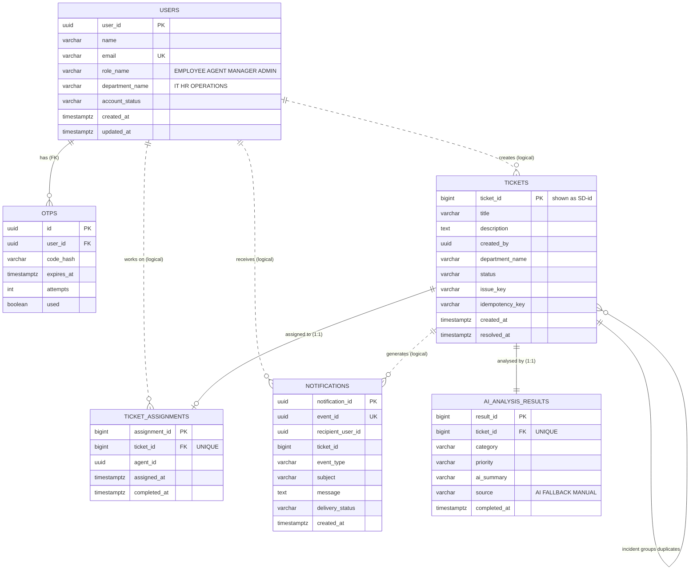

# SmartDesk – Database design (feat/infra-db-setup)

**Database-per-service:** each microservice owns its database. Services never join across databases;
cross-service references (e.g. `tickets.created_by` → `users.user_id`) are plain UUIDs without foreign keys,
so each service can be deployed and changed on its own.

| Database | Owner service | Tables | SQL |
|---|---|---|---|
| `smartdesk_auth_db` | api-gateway | users, otps | `db/02-auth-schema.sql` |
| `smartdesk_ticket_db` | ticket-service | tickets, ai_analysis_results, ticket_assignments | `db/03-ticket-schema.sql` |
| `smartdesk_notification_db` | notification-service | notifications | `db/04-notification-schema.sql` |
| Redis | ai-triage-service | AI response cache (24h) | – |

## ER diagram


Solid lines = real foreign keys (same database). Dotted lines = logical links across databases.

## Relationships
| Relationship | Type | Enforced by |
|---|---|---|
| tickets → ai_analysis_results | **1 : 1** | `UNIQUE (ticket_id)` + FK |
| tickets → ticket_assignments | **1 : 0..1** | `UNIQUE (ticket_id)` + FK. A ticket can't be claimed twice |
| tickets → tickets (incident) | 1 : many | Not stored: same `department_name` + `issue_key` within 4h of an earlier unresolved report = one incident |
| users → otps | 1 : many | FK, `ON DELETE CASCADE` |

## Constraints that protect the business rules
| Constraint | Rule |
|---|---|
| `ck_users_dept_by_role` | AGENT and MANAGER must have a department; EMPLOYEE and ADMIN must not |
| `ck_tickets_status` | Only the 5 lifecycle states exist |
| `uk_tickets_idempotency (created_by, idempotency_key)` | A double-clicked "Create ticket" can't create two tickets |
| `uk_notifications_event (event_id)` | A retried notification is stored and sent once |
| `ticket_assignments.ticket_id` UNIQUE | Two agents claiming at the same moment: the second insert fails (409) |

## Indexes and the query each one serves
| Index | Query |
|---|---|
| `idx_tickets_dept_status_created` | Department pool: `WHERE department_name=? AND status='OPEN' ORDER BY created_at` |
| `idx_tickets_creator_created` | Employee's "My tickets" |
| `idx_tickets_dept_created` | Tickets raised today per department (daily claim limit) |
| `idx_tickets_incident` | Duplicate check on every new ticket (same department + issue_key + open) |
| `idx_assignments_agent_day` | How many tickets an agent took today (daily claim limit) |
| `idx_analysis_category` | Filter / report by category |
| `idx_notifications_recipient_created` | "My notifications" |
| `idx_users_role_dept` | "List agents of IT" |

## Start and verify
```bash
copy .env.example .env          # Linux/Mac: cp .env.example .env
docker compose up -d
docker exec -it smartdesk-postgres psql -U smartdesk -c "\l"                             # 3 smartdesk_* databases
docker exec -it smartdesk-postgres psql -U smartdesk -d smartdesk_auth_db -c "\dt"         # users, otps
docker exec -it smartdesk-postgres psql -U smartdesk -d smartdesk_ticket_db -c "\dt"       # tickets, ai_analysis_results, ticket_assignments
docker exec -it smartdesk-postgres psql -U smartdesk -d smartdesk_notification_db -c "\dt" # notifications
docker exec -it smartdesk-postgres psql -U smartdesk -d smartdesk_ticket_db -c "\d tickets" # columns, constraints, indexes
docker exec -it smartdesk-redis redis-cli ping                                             # PONG
```
pgAdmin / DBeaver: host `localhost`, port `5432`, user `smartdesk`, password `smartdesk`.

The scripts run only on the **first** start (empty volume). After changing them: `docker compose down -v` then `docker compose up -d`.
This deletes all data.

## JPA entities (one per table)
| Table | Entity | Enums |
|---|---|---|
| users | `api-gateway/.../entity/AppUser.java` | `Role`, `Department` |
| otps | `api-gateway/.../entity/Otp.java` | |
| tickets | `ticket-service/.../entity/Ticket.java` | `TicketStatus` (state machine), `Department` |
| ai_analysis_results | `ticket-service/.../entity/AiAnalysis.java` | `Priority`, `TriageSource` |
| ticket_assignments | `ticket-service/.../entity/TicketAssignment.java` | |
| notifications | `notification-service/.../entity/Notification.java` | `EventType` (email templates), `DeliveryStatus` |

Column names follow Spring's default naming (`createdBy` → `created_by`), so each entity maps 1:1 onto the SQL above.
The entities compile once each service's `pom.xml` is added in its own feature branch.
